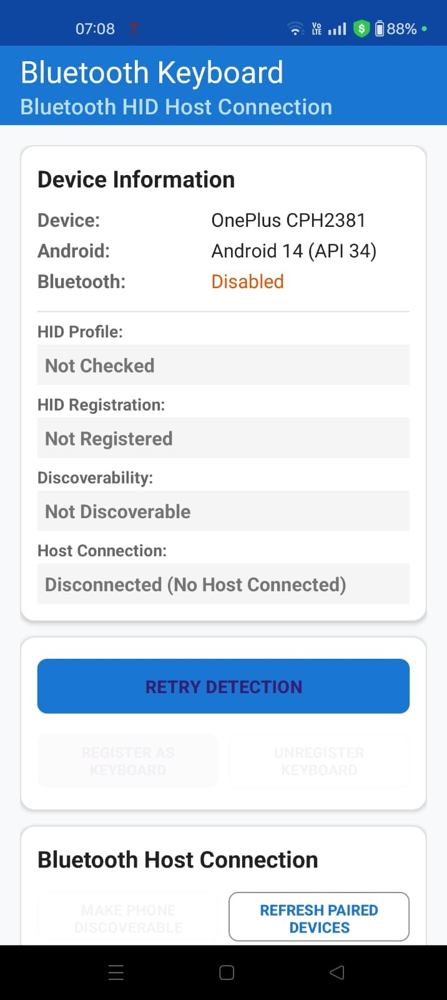
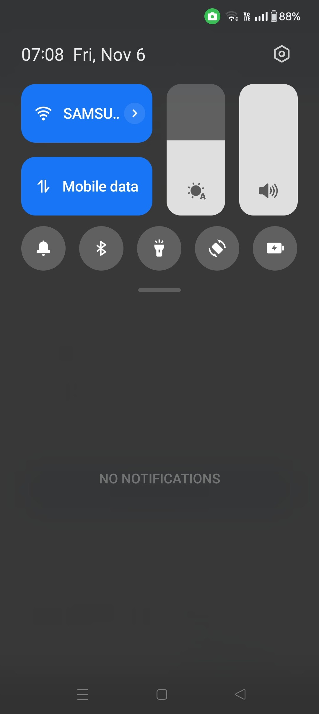
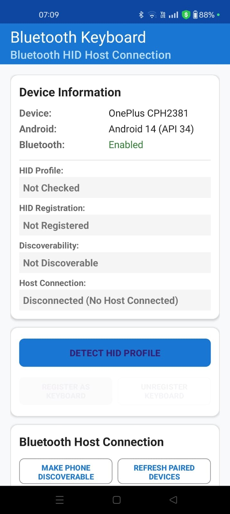
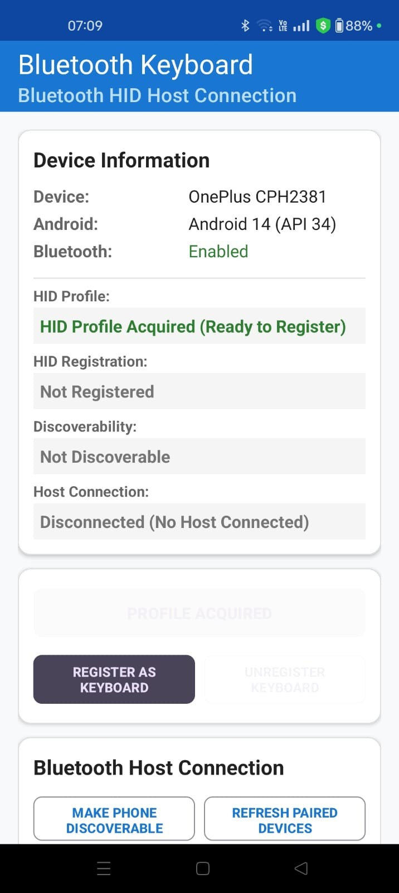
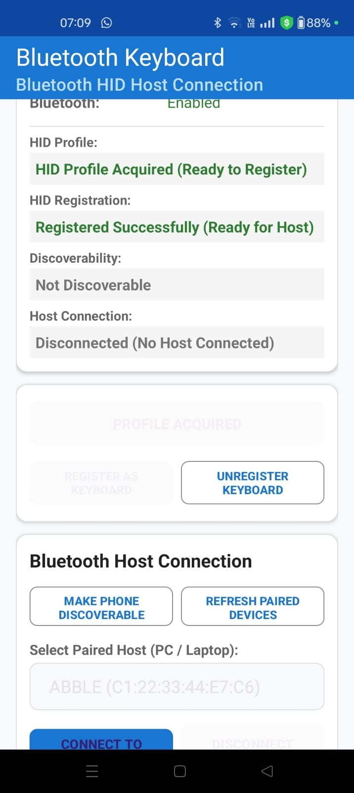
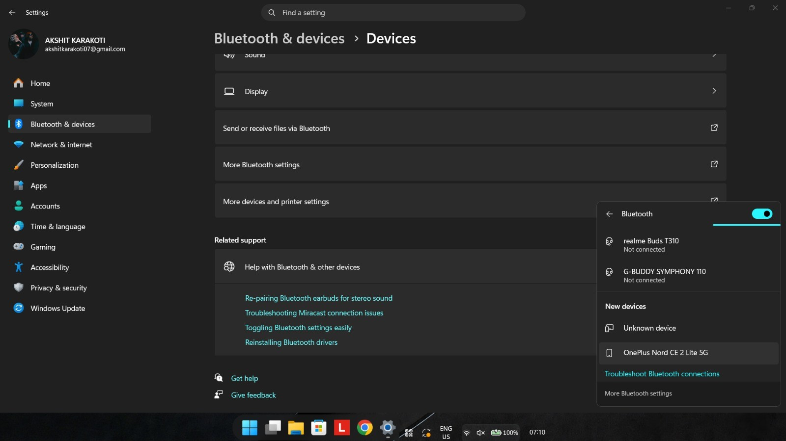
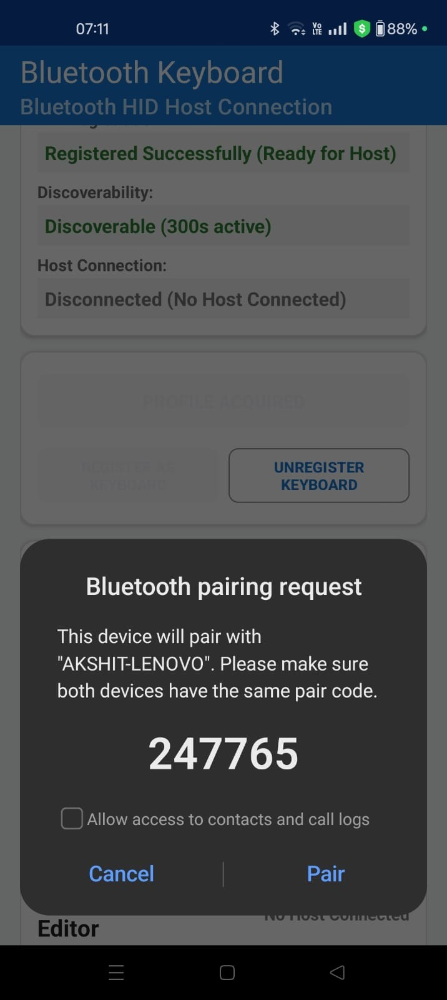
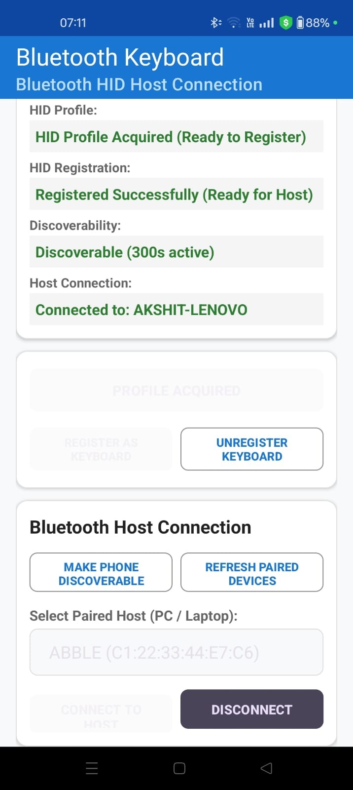
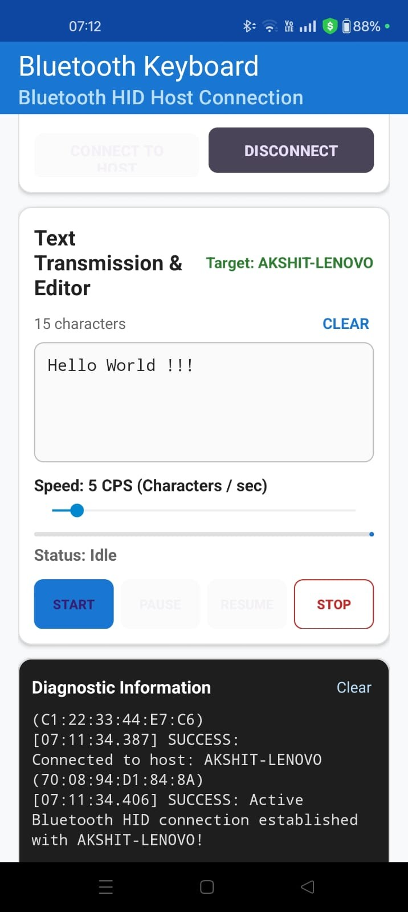

# ETHOS_KEYBOARD Releases

Official public distribution repository for **ETHOS_KEYBOARD** compiled Android application packages (APK) and documentation.

---

## About ETHOS_KEYBOARD

**ETHOS_KEYBOARD** transforms an Android smartphone into a standard wireless Bluetooth Classic HID (Human Interface Device) keyboard.

- **No Root Required**: Built entirely using official Android Bluetooth HID APIs (`BluetoothHidDevice`).
- **Zero Host Software**: Works without any receiver application, custom driver, or background daemon on target computers.
- **Universal Compatibility**: Plug-and-play with Linux (BlueZ UHID) and Windows 11.
- **Configurable Speed (1 to 50 CPS)**: Real-time slider controlling keystroke output rate up to 50 characters per second.
- **Full ASCII & Code Streaming**: Types all 95 printable US QWERTY characters (`0x20`–`0x7E`), plus Tab and Enter/Newline directly into IDEs, text editors, and browsers.
- **Safety Release Protocol**: Live Start, Pause, Resume, and Stop controls with guaranteed zero-report key releases preventing stuck keys.

---

## Downloads

| Asset | Description | Link |
|:---|:---|:---:|
| **ETHOS_KEYBOARD.apk** | Production-signed release APK | [📥 Download Latest APK](https://github.com/Akshit-Akshit/ETHOS_KEYBOARD_RELEASES/releases/latest) |
| **ETHOS_KEYBOARD_User_Manual.pdf** | Complete visual step-by-step PDF manual | [📖 Download User Manual (PDF)](./ETHOS_KEYBOARD_User_Manual.pdf) |
| **SHA256SUMS.txt** | Cryptographic checksum manifest | [📄 View SHA256SUMS](https://github.com/Akshit-Akshit/ETHOS_KEYBOARD_RELEASES/releases/latest/download/SHA256SUMS.txt) |

---

# 📖 Complete User Manual & Setup Guide

Follow this step-by-step guide to pair your Android phone and start streaming text and code to your computer.

### Step 1: Check Bluetooth Status
Open the **ETHOS_KEYBOARD** app on your phone. If Bluetooth is turned off, the status indicator will show that Bluetooth is disabled.

<p align="center">
  
</p>

---

### Step 2: Turn on Bluetooth
Swipe down the Android notification shade and toggle **Bluetooth ON**.

<p align="center">
  
</p>

---

### Step 3: Detect HID Profile
Return to the app and tap **DETECT HID PROFILE**. The status will turn green: `Profile Acquisition: SUCCESS`.

<p align="center">
  
</p>

---

### Step 4: Register as Keyboard
Tap **REGISTER AS KEYBOARD**. The application registers with the Android Bluetooth HID Device service and displays `Keyboard Registration: REGISTERED`.

<p align="center">
  
</p>

---

### Step 5: Make Phone Discoverable
Tap **MAKE PHONE DISCOVERABLE** to allow nearby Bluetooth devices to find your phone. The status will confirm discoverability is active.

<p align="center">
  
</p>

---

### Step 6: Pair from Your Computer
On your laptop or desktop (Windows 11 or Linux), open **Bluetooth & devices** settings and click **Add a device**. Select your phone from the list of available devices.

> [!IMPORTANT]
> **First-Setup Pairing Rule**: For the first setup after installing the app, always initiate the Bluetooth pairing from the **computer's Bluetooth settings** rather than from the phone. After the initial pairing completes successfully, subsequent connections may be initiated directly from the phone.

<p align="center">
  
</p>

---

### Step 7: Confirm Pairing Passkey
Confirm that the passkey shown on your computer matches the passkey shown on your phone's Bluetooth pairing prompt. Tap **Pair** on your phone and allow HID device access.

<p align="center">
  
</p>

---

### Step 8: Verify Active Connection
Return to **ETHOS_KEYBOARD**. The status will show `Host Connection: CONNECTED` with the name of your computer displayed under `Connected to: <Computer Name>`.

<p align="center">
  
</p>

---

### Step 9: Enter Text and Configure Typing Speed
1. Paste or type your desired text or code block into the text editor.
2. Adjust the **Speed (CPS)** slider between **1 and 50 characters per second** (e.g. 5 CPS for controlled input or 50 CPS for rapid transfer).
3. Focus your target application on your computer (VS Code, terminal, text editor, or browser search field).
4. Tap **START** on your phone.

<p align="center">
  
</p>

---

### Step 10: Automatic Keystroke Streaming
The app will transmit the keystrokes wirelessly via Bluetooth HID. You can tap **PAUSE**, **RESUME**, or **STOP** at any time during transmission. The text will appear directly in your computer's active window just as if it were typed on a physical keyboard.

<p align="center">
  
</p>

---

## Security & Verification

All official APK releases are signed with the developer's dedicated production key.

### SHA-256 Checksum Verification

#### On Linux / macOS:
```bash
sha256sum -c SHA256SUMS.txt
```

#### On Windows (PowerShell):
```powershell
Get-FileHash .\ETHOS_KEYBOARD.apk -Algorithm SHA256
```

Expected SHA-256 digest for v1.0.0:
```text
091c4123129aab844e63138883f694c86ca537c52e6c6483875fd9ec9e375f69
```

---

## Requirements

- **Android Device**: Android 9.0 (Pie / API 28) or higher with Bluetooth HID Device profile support.
- **Host Computer**: Any Bluetooth-enabled computer running Linux (BlueZ) or Windows 10/11. No special software or drivers required.

---

## Issues & Support

If you encounter any issues or have questions:
- Refer to the full [PDF User Manual](./ETHOS_KEYBOARD_User_Manual.pdf).
- Submit an issue on the [GitHub Issues Tracker](https://github.com/Akshit-Akshit/ETHOS_KEYBOARD_RELEASES/issues).
